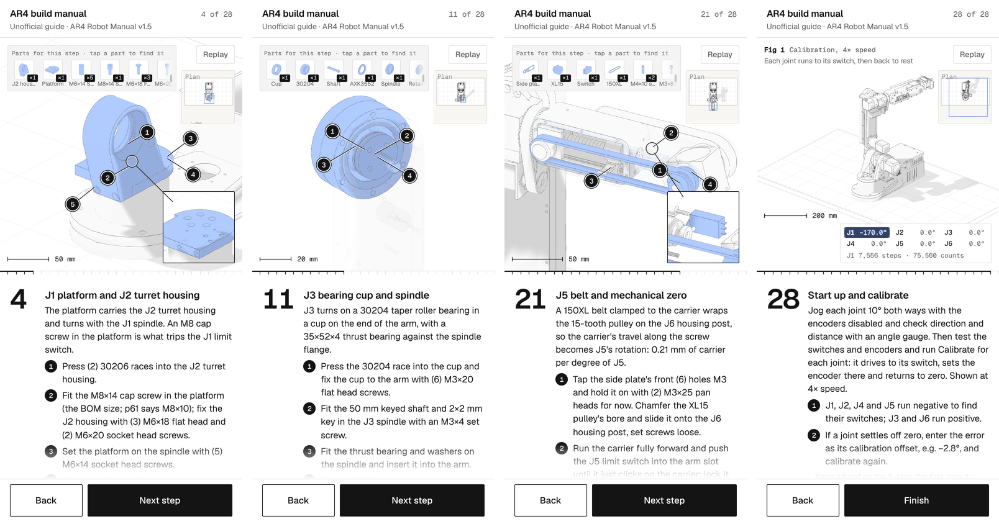
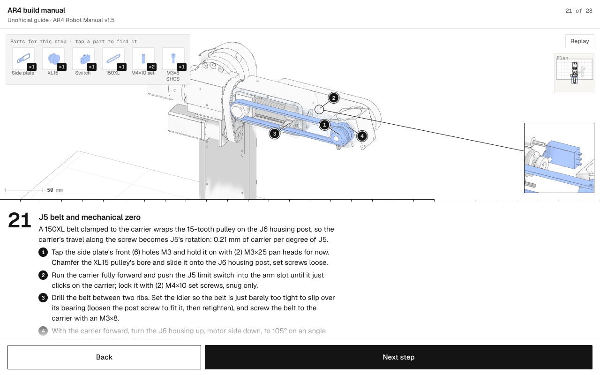
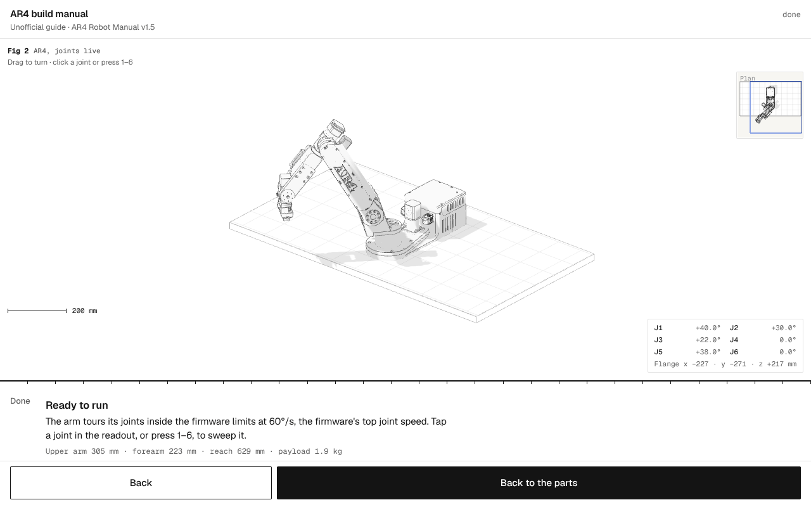

# AR4 build manual

An unofficial, animated, phone-first 3D build manual for the [Annin Robotics AR4](https://www.anninrobotics.com/) six-axis robot arm. It follows the **AR4 Robot Manual v1.5** step by step and draws every step on Annin's own CAD: parts fly into place, numbered marks point at what each instruction touches, and the finished arm moves through the same kinematics, joint limits and motor numbers the firmware uses.

**Live site:** https://ar4-build-manual.vercel.app



> This is an independent visual companion, not an Annin Robotics product. The AR4 Robot Manual is the authority: where this page and the manual disagree, follow the manual, and read it for the wiring diagrams, photos and safety notes this page leaves out. The manual is not included in this repository; download it from Annin Robotics.

## Contents

- [What's in it](#whats-in-it)
- [Using it](#using-it)
- [How it works](#how-it-works)
- [Where it differs from the v1.5 manual](#where-it-differs-from-the-v15-manual)
- [Repository layout](#repository-layout)
- [Building](#building)
- [Testing](#testing)
- [Regenerating the CAD data](#regenerating-the-cad-data)
- [Deploying](#deploying)
- [Credits and licences](#credits-and-licences)

## What's in it

A single HTML page (about 1.6 MB, of which about 1.4 MB is the embedded CAD geometry) plus a local copy of three.js, with 30 pages. The only outside request is for the Geist fonts, and the page falls back to system fonts without them.

| Page | Title | Manual pages |
| --- | --- | --- |
| Parts | What this builds: specifications and the full parts list, grouped after the manual's bill of materials | BOM, ch. 6 |
| 1 | J1 base enclosure | p58 |
| 2 | J1 base plate | p59 |
| 3 | J1 turret housing and bearings | p59–60 |
| 4 | J1 platform and J2 turret housing | p61–64 |
| 5 | J1 gear motor | p65–66 |
| 6 | J1 timing belt | p67–68 |
| 7 | J1 limit switch (and the encoder solder map) | p69–75 |
| 8 | J2 arm and bearings | p75–78 |
| 9 | J2 limit switch | p79–81 |
| 10 | J2 gear motor | p82–91 |
| 11 | J3 bearing cup and spindle | p92–95 |
| 12 | J3 gear motor and belt | p96–107 |
| 13 | J3 limit switch and loom | p107–117 |
| 14 | J2 covers and logo | p118–119 |
| 15 | J4 turret housing | p119–120 |
| 16 | J4 main shaft and timing hub | p120–123 |
| 17 | J5 motor into the J4 tube | p124–127 |
| 18 | J4 motor and belt | p127–130 |
| 19 | J5 carrier and housing | p130–140 |
| 20 | J6 bearing arm and housing | p140–144 |
| 21 | J5 belt and mechanical zero (J5 swings while the carrier rides the lead screw) | p144–153 |
| 22 | J5 side covers | p154–155 |
| 23 | J6 motor and gripper mount | p156–158 |
| 24 | Gripper (the jaws open and close) | p157–158 |
| 25 | J4, J5 and J6 switches and harness | p158–186 |
| 26 | Base connectors and lid | p187–205 |
| 27 | The control enclosure (text only; the controller is not drawn), with the manual's mains-safety warning | ch. 3 |
| 28 | Start up and calibrate: Fig 1, each joint runs to its switch at 4× speed with live step and encoder counts | ch. 7 |
| Done | Ready to run: Fig 2, the arm tours its joints; tap a joint to sweep it | ch. 6 |

Each build page has a parts tray, numbered actions with marks on the model, the manual's page numbers and a warning where the manual gives one. Some pages add a zoomed detail view, a cut-away (a part drawn faint so you can see behind it), or a camera angle that shows a part the default view hides.

## Using it

- **Next step / Back**, or swipe the text panel sideways, or use the **← →** keys. **Space** also goes forward unless a button has focus.
- **Tap a part in the tray** to make it blink in the model. Hardware drawn only in the tray (screws, nuts, washers) is listed but not tappable.
- **Drag the model** to turn it. **Replay** (or **r**) replays the step's animation.
- On the last page, **tap J1–J6 in the readout**, or press **1–6**, to sweep that joint through its full range.
- **Deep links:** `#step12` opens page 12 (`#step0` is the parts list; the last page is `#step29`). Without a hash the page reopens where you left off (stored in `localStorage`).
- **`&still`** after the hash (`#step21&still`) renders the page's finished state with no animation. Screenshots use it, and it is the same path that system **reduced motion** takes. With reduced motion, tapping a joint shows it turned halfway to its limit instead of sweeping it.
- **`?debug`** in the query string exposes `window.__ar4` (objects, pose function, kinematics, step list) and logs the belt-length checks to the console.

It works at phone width, on a phone held sideways (the text moves to a column beside the model), and on a desktop.





## How it works

### One model, every number

The numbers that come from the robot itself (joint limits, overall ratios, limit-switch pins, calibration directions and speed, belt lengths, arm lengths, CAD dimensions, specifications) are computed from one model in `src/scene.js` rather than typed into the copy. Catalogue sizes, fastener sizes, cable lengths and gearbox ratios are typed from the manual. The step text uses tokens that are resolved at load time:

| Token | Resolves to | Source |
| --- | --- | --- |
| `{range:n}` | joint limits, e.g. J2 −42° to +90° | `mk4.yaml` in ar4_ros_driver |
| `{ratio:n}` | overall reduction, e.g. J1 40:1 | firmware steps per degree × 360 ÷ motor steps per turn |
| `{pin:n}` | Teensy limit-switch pin (26–31) | manual and firmware `LIMIT_PINS` |
| `{caldir:n}` | which way calibration drives (J1, J2, J4, J5 negative; J3, J6 positive) | firmware calibration direction |
| `{sku:n}` | motor part number | manual BOM |
| `{belt:180XL}` | `180XL037, 457.2 mm` (the designation is the pitch length in tenths of an inch: 18.0 in) | belt designation |
| `{len:key}`, `{size:key}`, `{dia:key}` | measured from the CAD body, e.g. the J4 tube's 116.3 mm | `data/parts.json` |
| `{L23}`, `{L35}`, `{L56}` | upper arm 305 mm, forearm 223 mm, wrist to flange | URDF joint origins |
| `{travel}` | J5 carrier travel per degree, 0.21 mm | XL15 pitch radius (15 × 5.08 mm ÷ 2π = 12.13 mm) |
| `{specs}`, `{amps}`, `{calspeed}`, `{vmax}`, `{jaw}`, `{enc}` | reach, payload, driver currents, speeds, jaw travel, encoder counts | manual ch. 6 and p249, firmware, gripper URDF |

The motor numbers come from the manual's driver table (p249): every driver at ½ step except J5 at ¼ step, with 200-step motors. The steps-per-degree table is the firmware's MK2/MK3 table (`MOTOR_STEPS_PER_DEG_MK3`: `44.44, 55.56, 55.56, 49.78, 21.86, 22.22`), which matches the manual's driver settings; the firmware's MK4/MK5 tables are twice these values. The gear ratios, step counts and encoder counts (4,000 per motor turn) are derived from it. Calibration speed is the firmware's 1,000 motor steps per second (J5 at half), and the tour runs at its top joint speed of 60°/s.

### The CAD bodies

`tools/export_parts.py` reads the AR4 visual meshes from Annin's [ar4_ros_driver](https://github.com/Annin-Robotics/ar4_ros_driver) (`annin_ar4_description/meshes/ar4_mk5` and `ar4_gripper`) and splits each STL into its separate bodies: 145 in all. Each body is capped at 400, 1,600 or 2,400 triangles by size; bodies already under the cap are kept as they are. Small, very dense parts under 30 mm (threaded fasteners, knurled knobs) become clean cylinders: 39 of them. (A dense part that is neither round nor flat would become a simplified convex hull; none does today.) Four PG-21 gland-nut bodies (`BM1`–`BM4`) do not simplify below about 9,000 triangles each and make up about a third of the total. Altogether the geometry goes from about 1.0 million triangles to about 120,000. Positions are quantised to 16 bits inside each body's own bounding box and packed into `data/parts.bin`, with an index in `data/parts.json`. The build embeds the geometry in the page as base64 and inlines the index (minus the `tris`, `src` and `hull` fields) as a JavaScript array, `AR4_INDEX`.

Each body gets a code from its source file and index (`BA12` is body 12 of `Link_Base_Aluminum`, `4M0` is body 0 of `Link_4_Motor`). `src/kits.js` groups the bodies into the 90 kits a builder handles (the J2 arm, a pair of bearings, four M4 washers), names them after the manual, sorts them into the bill-of-materials groups and says which way each flies in from. The step that installs a kit is the one whose `parts` list in `src/config.js` names it.

### Kinematics

`src/scene.js` rebuilds the robot's frames from the URDF (`ar_macro.xacro`): joint origins, axes, the visual offsets of each link, and the gripper's two prismatic jaws. The scene is in feet (the engine's unit) and the model in metres. The arm's dimensions shown on the pages are measured from these frames, not typed in. On the calibration and finished pages every kit is re-posed through the same frames, and the J5 carrier moves along the lead screw by the belt travel for the current J5 angle.

### Parts the CAD leaves out

The visual meshes do not include the bearings, most of the pulleys and belts (only the J4 84XL belt, its XL10 pulley and the J6 XL15 pulley are in the CAD) or most of the J5 drive, so `src/proc.js` and `src/kits.js` draw 27 parts procedurally, to catalogue dimensions and placed on the CAD's own shafts and bores:

- taper roller bearings 32009, 30206, 30204 and 30203, B-1616 needle bearings, NTA1625 and AXK3552 thrust stacks, the 688Z bearing;
- XL and L timing pulleys with their real tooth counts, and belts drawn as tangent loops around them;
- the J5 lead screw, carrier (POM nut, four LM3UU bearings, belt clamp), rods, idler block and SV-166 limit switch.

The belts double as a check on the CAD where both centres come from it. For the 180XL and the 214L the page computes the pitch length from the CAD's shaft centres and compares it with the manual's belt (`?debug` logs this): the 180XL gives 458.8 mm against 457.2 mm, and the J3 214L does not fit (see below). The J5 idler is placed by hand (`J5.idler`, 69 mm along J4), so the 150XL's 382.1 mm against 381.0 mm checks that placement, not the CAD.

### The page engine

The page is built on the `starter.html` engine from the [3d-assembly-manual](https://github.com/SkylarKitchen/skills/tree/main/skills/design/3d-assembly-manual) skill: an orthographic three.js r128 scene, a step list with arrivals, marks, cut-aways and detail views, and a phone-first layout. `tools/build.py` keeps that engine and replaces only its `CONFIG` block (with `src/config.js`) and its `PROJECT SCENE` block (with `src/proc.js`, `src/scene.js` and `src/kits.js`). It also adds the overlay markup and CSS (`src/overlay.html`, `src/extra.css`) and the CAD data.

A handful of small engine fixes are applied as exact text swaps, each named in `build.py`. The build stops if the starter has changed underneath one of them:

- a metric scale bar (`CONFIG.scaleOpts`);
- marks that avoid the parts tray, plan inset and Replay button and push apart when they land on each other;
- keyboard handling (Space and Enter on a focused button press that button; ArrowRight and Space stop at the last page; modifier keys are ignored);
- only parts drawn in the model are tappable in the tray, with short names in the tray and full names as tooltips;
- Replay appears only where something replays; focus moves to Next when Back disables itself;
- tap-to-find shows a steady highlight under reduced motion;
- the step's warning sits above the page reference; the text panel announces step changes to screen readers; the canvas has a label.

### Authoring reference

Steps live in `src/config.js`. A step names its kits in `parts` (plus `hw:<size kind>:<qty>` for tray-only hardware such as `hw:M4x10 shcs:8`), its actions in `acts` as `[text, point, [dx, dy]]`, and optional `cam`, `cut`, `detail` and `kind` (`j5`, `grip`, `cal`, or the live last page).

Points for marks and detail views:

| Point | Meaning |
| --- | --- |
| `@kit` / `@kit^` / `@kit_` | centre, top or bottom of a kit's bounding box |
| `%CODE` | centre of one CAD body, e.g. `%BA12` |
| `~name` | a named point from `POINTS` in `src/kits.js` (e.g. `~platformRim`, a spot on the rim that the default view shows) |
| `#J2`, `#J2g`, `#F`, `#B` | joint origin, joint origin dropped to the ground, flange, base origin |
| `[x, y, z]` | an explicit point in scene units |

A camera is `{fit: [kits], pad, v, shift}`. It frames the listed kits from direction `v`. `shift` moves the framed box (in units of the frame radius) to keep it clear of the parts tray and the readout.

## Where it differs from the v1.5 manual

Annin's CAD is newer than the v1.5 manual in places, and the manual and its BOM sometimes disagree. The page says so where it matters:

- **Base rear panel and upper frame.** The CAD draws a newer rear panel and a vented frame. The v1.5 base has six GX16-4 sockets and three RJ45 keystone jacks; the page describes those and labels the drawn parts "newer CAD".
- **Gripper.** The manual fits an SMC MHF2-8D1 pneumatic gripper. The page draws Annin's servo gripper (DS3225MG) from its CAD and marks those steps as not from the manual; the MHF2-8D1 step is given as text.
- **J3 belt.** With the J3 motor where the CAD puts it, the belt path is 557.0 mm, against 543.6 mm for a 214L (21.4 in). The page names the belt "214L" and gives no length.
- **J6 ratio.** The J6 gearbox is 19:1, but the firmware's 22.22 steps per degree corresponds to 20:1. The page shows both.
- **Small mismatches** inside the manual, noted on the page: the J1 platform striker is M8×14 in the BOM and M8×10 in the step text; the J1 switch is SV-166-1C25 in the BOM and "SV-156" in the text.
- **Not drawn:** the control enclosure, cables, wiring and the pneumatic gripper. Their steps are text only.

## Repository layout

```
public/                  the static site Vercel serves (committed; rebuild after editing src/):
  index.html             the built page
  three-r128.min.js      three.js r128, served from the same origin
  THIRD_PARTY_NOTICES.txt  the licence notices, published with the site
src/config.js            the 30 pages: titles, copy, parts, marks, cameras
src/kits.js              CAD bodies grouped into kits; procedural part placements; named points
src/proc.js              procedural geometry: bearings, pulleys, belts, lead screw, hardware thumbnails
src/scene.js             the AR4 model (limits, ratios, kinematics), data decoding, tokens, live poses
src/extra.css            readout, figure label, landscape layout and other additions
src/overlay.html         markup for the live readout
data/parts.json, .bin    the 145 CAD bodies (index and packed geometry)
tools/build.py           assembles the page from the starter, src/ and data/
tools/export_parts.py    regenerates data/ from the ar4_ros_driver meshes
tools/shoot.mjs          headless-Chrome screenshots of any set of pages
tools/drive.mjs          headless-Chrome functional checks (clicks, keys, evals)
tools/montage.py         contact sheets from screenshots
vendor/starter.html      the 3d-assembly-manual engine (MIT)
vendor/three-r128.min.js three.js r128 (MIT), copied into public/ by the build
docs/screens/            README screenshots
build.sh                 builds public/ and dist/artifact.html
vercel.json              static hosting settings
```

## Building

The build needs only Python 3:

```sh
./build.sh
```

That writes:

- `public/index.html`: the complete page for static hosting, loading `three-r128.min.js` from the same folder (the build copies it there, with the licence notices as `THIRD_PARTY_NOTICES.txt`). It works without access to any CDN.
- `dist/artifact.html`: the page body without `<!doctype>`, `<head>` or `<body>`, for publishing as a claude.ai artifact. The host adds the wrapper, and three.js loads from cdnjs, as artifacts require.

Both carry the third-party licence notices as an HTML comment at the end. `build.py` can also be run directly; it creates the output folder if needed:

```sh
python3 tools/build.py vendor/starter.html src data public/index.html --standalone --local-three three-r128.min.js
python3 tools/build.py vendor/starter.html src data dist/artifact.html
```

Commit `public/` after rebuilding: Vercel serves it as-is and does not run the build.

## Testing

Run `./build.sh` first, then serve the repository root and open the built page:

```sh
python3 -m http.server 8765
# http://localhost:8765/public/index.html#step21
```

The screenshot and functional-check tools drive headless Chrome over the DevTools protocol. They need Node 22 or later and a Chrome or Chromium binary in `CHROME_PATH`, and create their output folder if it does not exist. When running as root (in a container, say), point `CHROME_PATH` at a small wrapper script that adds `--no-sandbox`.

```sh
# every page at phone size, finished state, 2× pixels, 2.5 s after load
CHROME_PATH=/path/to/chrome node --experimental-websocket tools/shoot.mjs \
  http://localhost:8765/public/index.html shots 390 844 2 2500 $(for i in $(seq 0 29); do printf "step$i&still "; done)

# a 4× close-up of a region (CSS px) is saved as stepN-zoom.png
CHROME_PATH=/path/to/chrome node --experimental-websocket tools/shoot.mjs \
  http://localhost:8765/public/index.html shots 390 844 2 2500 "step21&still@200,180,200,140"

# functional checks: go to a page, tap a joint, read the readout
CHROME_PATH=/path/to/chrome node --experimental-websocket tools/drive.mjs \
  http://localhost:8765/public/index.html shots 390 844 \
  '[["go","step29"],["wait",2500],["click","#roJ li:nth-child(5) button"],["wait",2000],["eval","document.querySelector(\"#roJ button.on\").textContent"]]'

# contact sheet (needs Pillow)
python3 tools/montage.py shots sheet.png 5 0.5 step1 step2 step3 step4 step5
```

`shoot.mjs` prints each page's viewport size and any exceptions or console errors it saw. Use `&still` for layout checks. With software rendering (SwiftShader) frames come slowly, so a capture without `&still` can catch a step mid-animation.

## Regenerating the CAD data

`data/` is generated once and committed. To regenerate it from a checkout of ar4_ros_driver (this build used commit `6a3ebb1`):

```sh
pip install numpy scipy trimesh fast-simplification networkx
M=/path/to/ar4_ros_driver/annin_ar4_description/meshes
python3 tools/export_parts.py $M/ar4_mk5 data $M/ar4_gripper
```

Body codes depend on the order the bodies come out of each STL (sorted by area). If the meshes change, check the codes used in `src/kits.js` and `src/config.js`: the page logs a console warning for CAD bodies that belong to no kit, and throws on a kit that names a missing body.

## Deploying

### Vercel

`vercel.json` sets no framework and `public/` as the output directory, so Vercel serves `public/` as static files with no install or build step. With the GitHub repository connected to a Vercel project, every push to `main` deploys to production. Run `./build.sh` and commit `public/` before pushing a change to `src/`.

### claude.ai artifact

`dist/artifact.html` is the same page without the document wrapper, for publishing as an artifact. Inside the artifact viewer only plain `#step12` anchors reach the page, so the `&still` and `?debug` options apply to the standalone page.

## Credits and licences

- **Annin Robotics** designed the AR4 and wrote the AR4 Robot Manual v1.5, which this page follows. The manual's text and photos are not reproduced here; the steps are paraphrased with page references. AR4 and Annin Robotics are their owners' names; this project is not affiliated with or endorsed by them.
- **[ar4_ros_driver](https://github.com/Annin-Robotics/ar4_ros_driver)** (MIT, © 2021 Dexter Ong): the CAD meshes the geometry is derived from, the URDF kinematics, the joint limits and the firmware constants.
- **[three.js](https://threejs.org/)** r128 (MIT, © 2010–2021 three.js authors), bundled in `vendor/` and served from `public/`.
- **[3d-assembly-manual](https://github.com/SkylarKitchen/skills/tree/main/skills/design/3d-assembly-manual)** skill (MIT, © 2026 Skylar Kitchen): the page engine in `vendor/starter.html`.
- **[anatomy](https://github.com/wheresryan22/anatomy)** skill (MIT, © 2026 Ryan): the approach of deriving every number from one model, the live readout figure, and close-up verification. No code from it is included.
- **Geist** and **Geist Mono** (SIL Open Font License) load from Google Fonts at runtime.

The full licence texts are in [THIRD_PARTY_NOTICES.md](THIRD_PARTY_NOTICES.md); the build also publishes them with the site and embeds them in the page. No licence has been chosen yet for this repository's own code.
